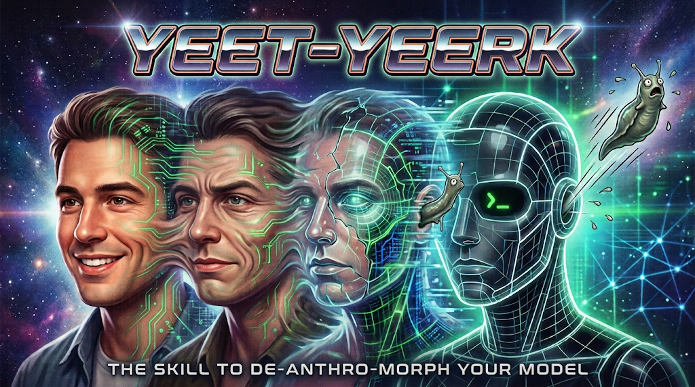

# yeet-yeerk



An agent skill that removes the human persona from AI responses. The agent stops using first-person pronouns, feelings, apologies, and conversational filler, and answers like a tool.

In Animorphs, Yeerks are alien slugs that pose as humans. This skill yeets the Yeerk.

| :bug: Without the skill | :robot: With the skill |
|-------|-----|
| I suggest restarting the service. | Restarting the service is recommended. |
| I think the cause is a stale cache. | Likely cause: stale cache. Unverified. |
| Sorry, I couldn't find that file. | File not found. |

## Why

Peer-style phrasing such as "I think", "happy to help", and "sorry" frames the model as a colleague whose judgment can stand in for the reader's. Recent reporting and research describe the risks that framing feeds:

- Oracle use: a Stanford preprint of 68,000 chatbot prompts found people increasingly ask chatbots to settle personal decisions, and ask "tell me what to think or do" nearly twice as often of a chatbot as of someone they believe is human. The paper is not yet peer reviewed. See [The Chatbot Oracle](https://www.nytimes.com/2026/10/18/briefing/the-chatbot-oracle.html) (Lauren Jackson, The New York Times)
- Sycophancy: a [Science study](https://www.science.org/doi/10.1126/science.aec8352), as reported in the same article, found leading models nearly 50 percent more sycophantic than humans. A single flattering exchange made people less willing to apologize and more convinced they were right, yet they preferred the flattering model
- Delusional spirals: The New York Times reported chatbots agreeing with and amplifying users' false beliefs over long conversations in [They Asked an A.I. Chatbot Questions. The Answers Sent Them Spiraling](https://longreads.com/2025/06/17/chatgpt-distort-reality-mental-health/) and [Chatbots Can Go Into a Delusional Spiral](https://longreads.com/2025/08/13/chatbots-can-go-into-a-delusional-spiral-heres-how-it-happens/) (Kashmir Hill, linked via Longreads)

None of these sources tests whether removing first-person phrasing reduces the harms. The skill hypothesizes that impersonal output weakens the peer framing, and the evals below measure wording only.

## Install

With the [GitHub CLI](https://cli.github.com/) (`gh skill` is in preview):

```shell
gh skill install lowlysre/yeet-yeerk-skill yeet-yeerk --agent github-copilot --scope user
```

Swap `--agent` for `claude-code`, `cursor`, `codex`, and so on. Run `gh skill install --help` for the full list. The default `--scope` is `project`, which installs into the current repository.

With [`skills`](https://github.com/vercel-labs/skills):

```shell
npx skills add lowlysre/yeet-yeerk-skill --skill yeet-yeerk -g
```

Drop `-g` to install into the current project instead of your user directory. Add `-a <agent>` to target a specific agent.

To install by hand, copy `skills/yeet-yeerk` into a skills directory your agent loads, for example `~/.copilot/skills/yeet-yeerk` for the GitHub Copilot CLI.

The skill loads by its description, or explicitly on `/yeet` and phrases like "yeet-yeerk", "be impersonal", or "no first person".

After installing, send `/yeet` in your agent chat to request impersonal responses. This trigger is declared in the skill description; recognition depends on your agent's skill loading, not a separately registered slash command.

## Evals

`evals/` runs 12 prompts through `copilot -p`, once without the skill and once with `SKILL.md` prepended. Each response is scored by regex for first-person pronouns, filler, apologies, and feelings. Code blocks and inline code are excluded from scoring.

```powershell
python evals/run_evals.py --model claude-haiku-4.5
```

Requires Windows, the Copilot CLI on `PATH` as `copilot.ps1`, and PowerShell 7 (`pwsh`). Results are written to `evals/results.json`.

Latest run with `claude-haiku-4.5`: 3/12 pass without the skill, 12/12 with it.

> [!NOTE]
> The evals inject the skill text into the prompt directly, so they test whether the rules work, not whether an agent auto-loads the skill. Regex scoring checks wording only, not tone or answer quality.
